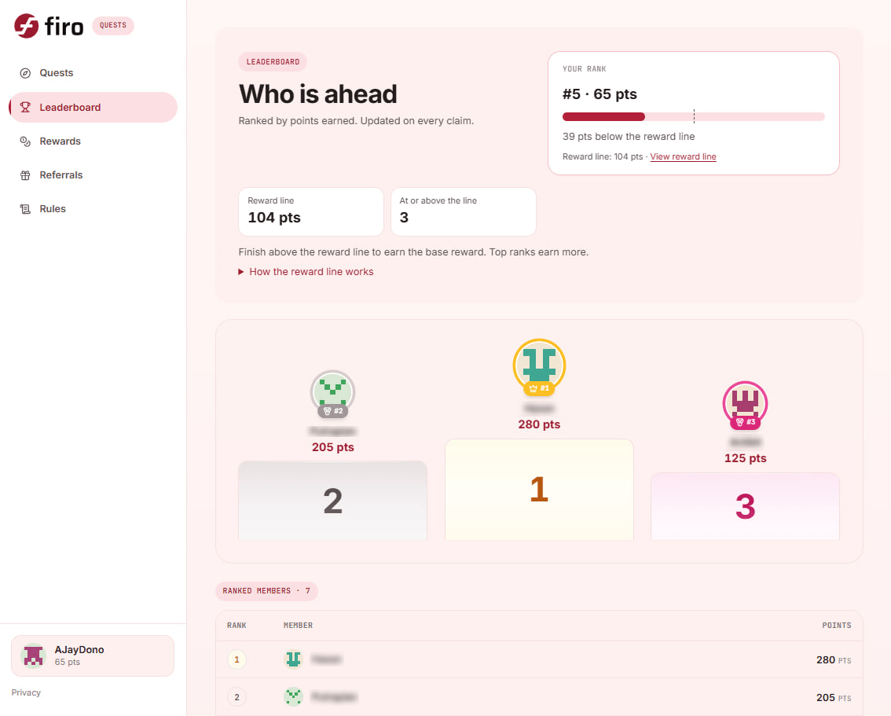

We’re launching [**Firo Quests**](https://quests.firo.org/), our community rewards platform for learning about Firo, contributing to its growth and earning FIRO along the way.

We built it to give newcomers a clearer starting point and give the FiroFam more ways to get involved. Our aim is to help more people discover Firo, become comfortable using it and contribute to a network that makes financial privacy accessible.

A shared post can introduce someone to Firo for the first time. A quiz can help them understand what Spark protects. A useful tutorial can give them the confidence to try a private transaction. Firo Quests brings these steps together and rewards the people who help others take them.

We're launching something we've been building for the FiroFam: Firo Quests, our own community rewards platform.

Firo Quests is a place where community participation earns real rewards. Complete tasks, rack up points, climb the leaderboard, and win Firo.

## What Is Firo Quests?

Firo Quests is our standalone quest platform, built and operated by the Firo team. Building it ourselves lets us tailor quests and rewards to our community, expand into activities on the Firo network, and make deliberate choices about what participant information is collected and ensure they are protected.

**This launch is the first phase**. It focuses mainly on social participation, learning and spreading the word: joining our communities, engaging with Firo’s content, completing quizzes and contributing content of your own. These activities help us reach people who might otherwise never come across Firo and give them somewhere to begin. It also helps existing holders of Firo who may not have had the chance to explore Firo’s other features.

We are already in the process of expanding quests that encourage direct use of the ecosystem, including on-chain transactions on the Firo network, Spark Names, mining and incentives for providing liquidity which will come in the second phase. The longer-term goal is to turn that initial interest into people using Firo, helping others use it and making it easier to access.

## How Privacy is protected?

Building the platform ourselves allows us to make deliberate choices about privacy which is why we didn’t use existing campaign platforms like Zealy or Galxe.

A rewards platform needs some information to verify participation, prevent abuse and arrange payments. As a privacy-focused project, we wanted control over what is collected, and how they are protected. That shaped several decisions:

* **Sensitive details are encrypted before storage.** This includes email and wallet addresses, linked social-account details, submitted links and files. Encryption keys are stored separately from the database, helping protect those details if stored records are somehow leaked without the keys. 
* **We use no advertising, analytics, trackers or fingerprinting.** Your personal information is not shared to any third parties. 
* **The public leaderboard uses your display name.** It shows your points, rank and qualification status without publishing your email or wallet addresses. 
* **You choose how to sign in.** The platform supports email, a privacy-preserving Firo Spark address or an EVM wallet. Social accounts are linked for quests that need them; we never receive your social-account passwords, and the access tokens used to identify you are not retained.

You can also request account deletion from your profile. Our [privacy policy](https://quests.firo.org/privacy) explains the seven-day restoration period, cleanup process and limited records retained for auditing and preventing repeat claims. For Spark payments, the reward amount and recipient are hidden on the Firo blockchain.

## How It Works

Log in to the platform, and you'll see a list of available quests across different categories. Each quest has a point value attached to it. Complete the quest, submit your claim, and the points are added to your total.

Quests range from quick social tasks to more involved challenges like writing tutorials or creating content about Firo. The platform tracks everything: your points, your rank on the leaderboard, and what you've completed versus what's still available.

As more quests are added over the campaign, the total points on offer grows. Your standing is always measured against the full picture, so there's always something worth coming back for.

## The Leaderboard

The leaderboard tracks everyone who's participating and ranks them by total points earned. It updates on every claim, so you'll always know where you stand. The top spots are competitive, and that's the point.

## Rewards

The campaign runs for roughly 8 weeks. As the weeks progress, more quests are added.

Here's how rewards work:

**How to get ranked:** Join the Firo Discord and Telegram, follow @firoorg on X, and complete 3 quizzes. To qualify, finish above the reward line. The reward line moves as more quests open, so there's always a clear target to aim for.

**Base reward:** Every qualified member earns a base reward of US$2, paid out in leaderboard order up to the cap. Top-ranked members also earn a bonus on top.

**Growing prize pool:** The pool grows as more members qualify. It starts with prizes for the top 3 and reaches US$600 with 100 qualified members. As more people join, the pool scales up.

**Payout:** All prizes are paid in FIRO at the 7-day average CoinGecko price at campaign close, never below 70% of the launch-day price.

## Built for the Firo Community

This platform exists for you. Every quest on it is a way for someone who cares about Firo's success to contribute directly - whether that's sharing a post, learning something new about Spark, or creating content that helps others discover financial privacy.

Whether you’re discovering Firo today or have been part of the FiroFam for years, we’d love you to join us. Learn something new, help someone else discover financial privacy and take part in building a more active Firo ecosystem.

We'll keep adding quests, expanding reward structures, and building on this as the community grows.

