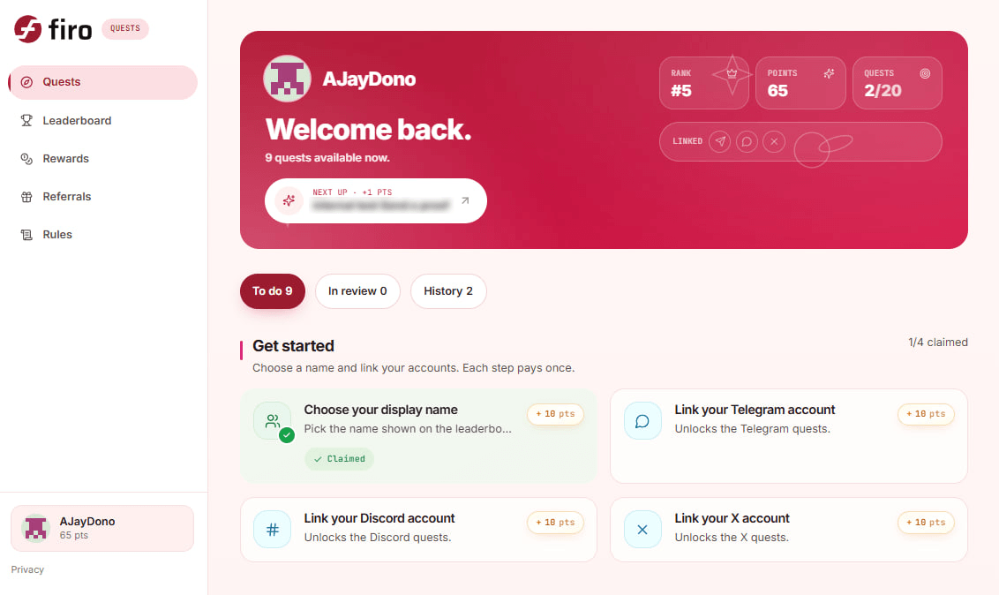
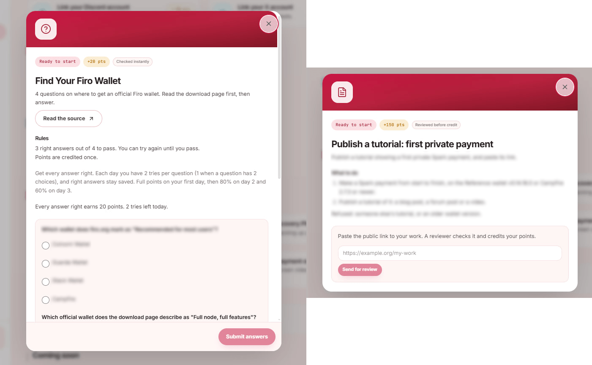

We're launching something we've been building for the FiroFam: [**Firo Quests**](https://quests.firo.org/), our own community rewards platform.

Firo Quests is a place where community participation earns real rewards. Complete tasks, rack up points, climb the leaderboard, and win FIRO.

## What Is Firo Quests?

Firo Quests is our standalone quest platform, built and run entirely by us. It's not tied to any third-party platform, which means we have full control over what quests we create, how points are awarded, and how rewards are structured. We can customize everything to fit the Firo community and what matters to us.

The more you participate in the Firo ecosystem, the more points you earn. Bigger tasks come with bigger point rewards, and more points means a better shot at earning rewards.

## How It Works

Log in to the platform, and you'll see a list of available quests across different categories. Each quest has a point value attached to it. Complete the quest, submit your claim, and the points are added to your total.

Quests range from quick social tasks to more involved challenges like writing tutorials or creating content about Firo. The platform tracks everything: your points, your rank on the leaderboard, and what you've completed versus what's still available.

As more quests are added over the campaign, the total points on offer grows. Your standing is always measured against the full picture, so there's always something worth coming back for.

## The Leaderboard

The leaderboard tracks everyone who's participating and ranks them by total points earned. It updates on every claim, so you'll always know where you stand. The top spots are competitive, and that's the point.

## Rewards

The campaign runs for roughly 8 weeks. As the weeks progress, more quests are added.

Here's how rewards work:

**How to get ranked:** Join the Firo Discord and Telegram, follow @firoorg on X, and complete 3 quizzes. To qualify, finish above the reward line. The reward line moves as more quests open, so there's always a clear target to aim for.

**Base reward:** Every qualified member earns a base reward of US$2, paid out in leaderboard order up to the cap. Top-ranked members also earn a bonus on top.

**Growing prize pool:** The pool grows as more members qualify. It starts with prizes for the top 3 and reaches US$600 with 100 qualified members. As more people join, the pool scales up.

**Payout:** All prizes are paid in FIRO at the 7-day average CoinGecko price at campaign close, never below 70% of the launch-day price.

## Built for the Firo Community

This platform exists for you. Every quest on it is a way for someone who cares about Firo's success to contribute directly - whether that's sharing a post, learning something new about Spark, or creating content that helps others discover financial privacy.

We'll keep adding quests, expanding reward structures, and building on this as the community grows.

Head over and get started: [https://quests.firo.org/](https://quests.firo.org/)

Welcome to Firo Quests

